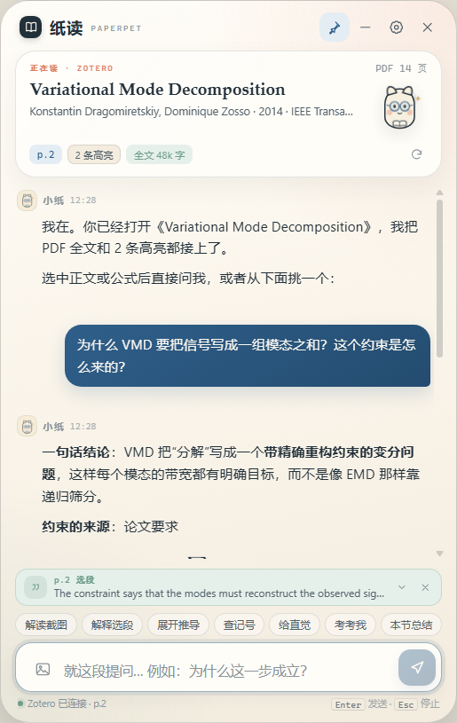
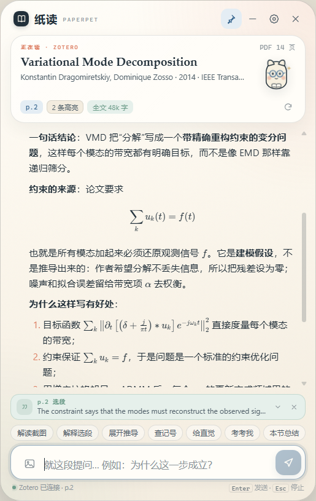
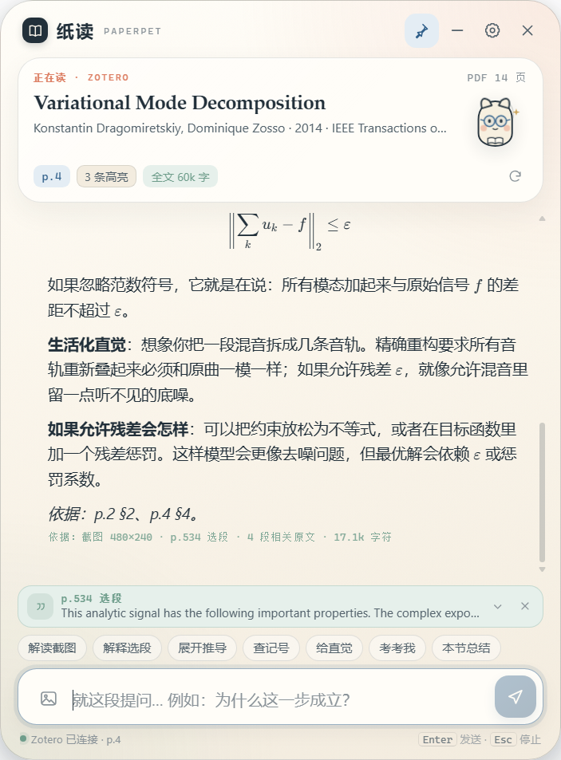

# 纸读 PaperPet

[English](README.md) | **简体中文**

> 会陪你读论文的桌宠。知道你在 Zotero 里读哪一篇，能就正文、公式、假设和推导回答你的疑惑。

纸读是一个 **Windows 桌面悬浮窗**：平时是一只趴在屏幕角落的小纸宠，点开就是一个论文研读面板。它通过一个轻量 Zotero 插件读取当前打开的 PDF、所在页码、选中文字、高亮和全文，再把这些上下文交给 DeepSeek（或任意 OpenAI 兼容接口）做精读问答。

针对 **统计学、概率论、机器学习理论、应用数学** 的英文论文设计：回答会标注页码/章节、区分 definition / assumption / theorem、逐步展开推导、用 LaTeX 渲染公式，并在上下文不足时明确说“论文这里没有写”。

---

## 它现在能做什么

- **知道你正在读哪篇**：Zotero 里切换 PDF，桌宠同步切换论文；显示标题、作者、年份、期刊、PDF 页数。
- **选中即问**：在 PDF 里双击/拖选一段文字，面板底部出现“p.X 选段”胶囊，提问时自动带上选段、所在页和邻近上下文。
- **整篇精读**：读取 Zotero 的 PDF 全文缓存，按页切分，自动识别章节（Roman / 数字 / 字母小节）和定理、定义、假设。
- **智能检索**：对中文问题做术语扩展（“约束 → constraint”“残差 → residual”…），用 BM25 找出最相关的 5 段原文，连同当前页、选段、Zotero 高亮一起送给模型。
- **公式渲染**：行内 `$...$`、独立公式 `$$...$$` 都用 KaTeX 渲染，流式输出时也不会把公式拆坏。
- **截图解读**：按 `Win+Shift+S` 截公式 → 回到纸读按 `Ctrl+V`（或点输入框左侧的图片按钮 / “解读截图”），图片会先显示缩略图；发送后模型**先逐字转写成 LaTeX，再解释**。适合 PDF 文本层把公式抽丢的情况。
- **复杂公式主动举例**：遇到多重求和、积分、期望、范数、约束优化等复杂公式，小纸会先用 2–4 句生活化类比或低维数值特例建立直觉，再进入严格推导，不需要你每次说“举个例子”。
- **可调整的窗口**：拖动窗口四边/四角改变大小；字号会随窗口按比例缩放（约 0.9×–1.35×），不会出现窗口变大字还是很小的情况。
- **六种快捷研读**：解释选段、展开推导、查记号、给直觉、考考我、本节总结。
- **对话记忆**：按论文分别保存历史；切换论文自动切换对话；重启后还在。
- **桌宠形态**：透明、无边框、始终置顶、可拖动；收起后只剩一只小纸宠和一句话；托盘图标可唤回；`Ctrl+Alt+P` 全局显示/隐藏。
- **隐私可控**：API Key 用 Windows DPAPI 加密；只有你主动提问时才发送当前论文的相关片段；插件只在本机写 JSON，不联网。







---

## 快速开始（打包版）

### 1. 启动

双击解压目录里的 **`启动纸读.vbs`**（无控制台窗口）。

> 为什么不直接双击 `PaperPet.exe`？
> 某些 Windows Server / 远程桌面会话没有可用的 Chromium GPU 沙箱，Electron 会在启动时崩溃。`启动纸读.vbs` 会带 `--no-sandbox` 启动；渲染进程仍然启用了 `contextIsolation`、关闭了 `nodeIntegration`。
> 也可以双击 `创建桌面快捷方式.ps1` 生成带同样参数的桌面快捷方式。

### 2. 填入模型 API Key

点桌宠右上角 **设置 → 模型连接**：

- Base URL：默认 `https://api.deepseek.com`，也可填 OpenAI、硅基流动、学校网关、Ollama 等兼容地址。
- API Key：只保存在本机（Windows DPAPI 加密）。
- 模型：默认 `deepseek-chat`；点“拉取”可以读取接口返回的模型列表。
- 截图模型：如果用于截图解读，需要填写支持图片输入的模型（如 `deepseek-flash`、`gpt-4o` 或你网关里的视觉模型）；留空则复用上面的模型。
- 点“测试连接”，看到“连接正常”即可。

> 也支持环境变量 `DEEPSEEK_API_KEY`（设置里的 `keySource` 会显示“环境变量”）。

### 3. 安装 Zotero 桥接

**方式 A（推荐，Zotero 运行时）**

1. 在纸读里点 **设置 → Zotero 桥接 → 打开插件文件**；
2. Zotero → **工具 → 插件 → 右上角齿轮 → Install Plugin From File…**；
3. 选择 `paperpet-bridge.xpi`；
4. 不需要重启，Zotero 7/8/10 支持运行时安装 bootstrapped 插件。

**方式 B（Zotero 已退出）**

1. 完全退出 Zotero（包括托盘图标）；
2. 纸读 **设置 → 一键安装 / 更新**；
3. 重新打开 Zotero。

预编译的插件也放在：[`prebuilt/paperpet-bridge.xpi`](prebuilt/paperpet-bridge.xpi)。

桥接插件只做一件事：把当前 PDF 的元数据、全文缓存、页码、选段和批注写到

```
%APPDATA%\PaperPet\bridge\context.json
%APPDATA%\PaperPet\bridge\papers\<attachment-key>.txt
```

纸读读取这些本地文件。插件没有任何网络请求。

### 4. 开始读

1. 在 Zotero 里打开一篇 PDF；
2. 纸读的论文卡会自动出现标题；
3. 在 PDF 里选中一句话 / 双击一个词；
4. 在纸读里点“解释选段”，或直接输入问题；
5. 公式抽取不全时：`Win+Shift+S` 截图 → 回到纸读按 `Ctrl+V` → 点发送。

---

## 使用小技巧

| 场景 | 怎么做 |
|---|---|
| 这一步为什么成立 | 选中那一步，点 **展开推导** |
| 这个 λ 是什么 | 选中含 λ 的式子，点 **查记号**；或直接问“λ 是什么” |
| 公式抽取乱码 | 按 `Win+Shift+S` 截公式，回纸读按 `Ctrl+V`，点发送；模型会先转写 LaTeX 再解释 |
| 没读懂整节 | 点 **本节总结**，或问“这一节的证明路线是什么” |
| 检验自己 | 点 **考考我**，先只看问题，再看参考答案 |
| 换一篇论文 | 在 Zotero 里打开另一个 PDF；对话自动切换 |
| 字太小 / 想多看几行 | 拖动窗口四边或四角；字号会跟着缩放 |
| 只想要桌宠 | 点标题栏的“—”；点小纸宠的对话气泡展开 |
| 临时隐藏 | 点“×”或托盘图标；`Ctrl+Alt+P` 全局切换 |

---

## 配置项

- **阅读上下文**
  - `智能`（默认）：标题/摘要/章节图 + 当前页 + 选段 + 5 段 BM25 检索；约 15–25k 字符。
  - `全文`：整篇 PDF 塞进 system prompt；最完整，也最贵。
  - `仅选段`：只发选段 + 当前页；最省、最私密。
- **上下文预算**：24k / 60k / 120k / 240k 字符。
- **显示思考过程**：如果模型返回 `reasoning_content`，默认折叠。
- **始终置顶 / 开机启动 / 主题**。
- **主题**：跟随系统、纸感浅色、夜读深色。
- **截图 / 图片理解模型**：与主模型分开配置；只影响带图片的提问。
- **窗口大小**：拖动边缘即可；尺寸会记住，下次启动沿用，字号按尺寸自动缩放。

---

## 隐私

- 论文内容只在**你点击发送**时进入请求；插件同步本身不联网。
- 截图会发送到你配置的“截图 / 图片理解模型”接口；图片只保存在当前对话的缩略图里，不写入 Zotero。
- API Key 使用 Electron `safeStorage`（Windows DPAPI）加密后写入 `config.json`；也支持只放在环境变量里。
- 对话按论文保存在 `%APPDATA%\PaperPet\desktop\conversations\`，不上传。
- 模型接口由你自己配置；如果你填的是第三方中转，请自行确认其隐私政策。
- “仅选段”模式下只发送选中文字和当前页，不发送整篇全文。

---

## 目录与数据

```
%APPDATA%\PaperPet\
├─ bridge\                 # Zotero 桥接插件写入
│  ├─ context.json         # 当前论文 + 页码 + 选段 + 高亮
│  ├─ plugin.log           # 插件日志（排查用）
│  └─ papers\<key>.txt     # PDF 全文缓存
└─ desktop\                # 纸读本体
   ├─ config.json          # 配置（Key 加密）
   └─ conversations\       # 按论文分的对话
```

---

## 开发

```bash
# 依赖
pnpm install
node node_modules/electron/install.js   # 如 pnpm 跳过了 Electron postinstall

# 同步前端 vendor（marked / DOMPurify / KaTeX）
node scripts/sync-vendor.mjs

# 构建 Zotero 插件 .xpi
pnpm build:plugin

# 启动（开发）
pnpm start                # 已带 --no-sandbox
pnpm demo                 # 演示数据，不需要 Key / Zotero

# 单元测试
pnpm test:context

# 打包 Windows 便携目录
pnpm package
```

### 结构

```
paperpet/
├─ electron/
│  ├─ main.js              # 窗口 / 托盘 / IPC / 截图 / 插件安装
│  ├─ preload.js           # 安全 IPC 暴露
│  ├─ config.js            # 配置 + DPAPI
│  ├─ zotero-bridge.js     # 读 context.json，监听论文切换
│  ├─ paper-context.js     # 全文清洗、章节、BM25、prompt 装配
│  ├─ llm.js               # OpenAI 兼容 SSE 流式
│  └─ history.js           # 按论文分文件的历史
├─ src/                    # 桌宠 UI（原生 HTML/CSS/JS + KaTeX）
├─ zotero-plugin/          # manifest.json + bootstrap.js
├─ scripts/                # 构建 / 图标 / 打包 / mock LLM
└─ test/                   # node:test 单元测试
```

### 设计取舍

- **不用向量库**：单篇论文 5–50k 词，BM25 + 章节标题足够；零额外依赖、毫秒级。
- **system prompt 稳定**：论文 dossier（标题/摘要/章节图/全文）放在 system，问题相关的选段和检索结果放在 user；同一篇论文反复提问更容易命中 API 的 prefix cache。
- **插件写文件而不是开 HTTP 端口**：不占端口、不受 Zotero 本地 API 开关影响、不需要处理 CORS；桌面端只读。
- **本地加密而不是明文 Key**：`safeStorage` 不可用时退回 base64 并提示（`config.js` 有注释）。

---

## 已知限制

1. **PDF 公式字形可能缺失**。很多数学 PDF 的公式使用 Type3 / 无 ToUnicode 的字体，Zotero 的文本层会丢掉 `ω_k`、上下标等。纸读提供**截图解读**作为兜底：按 `Win+Shift+S` 截公式，回纸读按 `Ctrl+V`，视觉模型会先转写 LaTeX 再解释。这需要你的接口支持图片输入；如果当前模型不支持，设置里单独填一个视觉模型。
2. **一键安装要求 Zotero 已退出**。Zotero 运行时写 `extensions.json` 会被覆盖，所以设置里改为“打开插件文件”，按官方插件管理器安装。
3. **没有自动写 Zotero 笔记**。回答可以一键复制；笔记功能不在本版范围。
4. **只在 Windows 上打包/实测**。核心代码是跨平台的，但托盘、开机启动和安装脚本针对 Windows。
5. **模型能力决定上限**。默认 `deepseek-chat`；复杂推导可换更强的模型；截图解读必须用支持 vision 的模型。上下文越长越贵。

---

## 排错

| 症状 | 检查 |
|---|---|
| 面板一直“等待 Zotero…” | Zotero 是否运行？桥接插件是否启用？`%APPDATA%\PaperPet\bridge\plugin.log` 有没有 `started` |
| 论文卡空白 / “还没打开论文” | 在 Zotero 里双击 PDF，让 reader 标签页成为当前标签；等 2 秒 |
| 选段不出现 | 在 PDF 文本上双击或拖选；扫描版 PDF 没有文本层，无法选段 |
| 安装后 Zotero 没反应 | 完全退出 Zotero 再打开；工具 → 插件 里确认 PaperPet Bridge 已启用 |
| 401 / 402 | Key 无效或余额不足；设置里点“测试连接” |
| 404 / 模型不存在 | Base URL 是否多了/少了 `/v1`；点“拉取”看模型名 |
| 发送后没反应 | 看设置里 Base URL 是否可达；代理/防火墙；换 `deepseek-chat` |
| 双击 `PaperPet.exe` 崩溃 | 用 `启动纸读.vbs`（带 `--no-sandbox`），或创建桌面快捷方式 |

---

## 测试

- 8 个纯函数单测：文本清洗、mojibake 修复、分页、章节识别、BM25、选段定位、prompt 装配、摘要回退。
- 端到端用本地 mock OpenAI SSE 服务验证：流式、KaTeX、上下文元信息、历史写入。
- 截图链路用 mock vision 请求验证：剪贴板读图、缩略图、`image_url` 消息、视觉模型选择。
- 与 Zotero 10.0.6 + 真实 PDF（Variational Mode Decomposition）实测：当前论文、页码、全文缓存、拖选/双击选段、高亮读取。
- 自定义边缘缩放实测：从 410×650 拖到约 514×654，窗口与字号同步变化。

```bash
pnpm test:context
```

---

## License

MIT. 仅用于个人学习与研究；请遵守论文与模型服务的版权/使用条款。

---

作者：[21aQ](https://github.com/21aQ) · 项目主页：[github.com/21aQ/PaperPet](https://github.com/21aQ/PaperPet)
